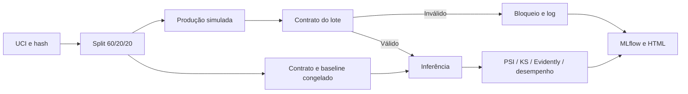

# Tech Challenge 4 — Confiabilidade de modelos de crédito

Contratos de dados, data/concept drift, relatórios estatísticos, logs, infraestrutura e governança para um classificador acadêmico de inadimplência.

**Estado: pipeline técnico executado e validado localmente.** Vídeo e submissão institucional pendentes.

**Validação:** 38 testes passaram, CI Linux aprovado e demo completa com 30.000 registros. Controle sem alertas; lote inválido bloqueado; LIMIT_BAL/PAY_AMT1 detectadas; concept drift com recall de 0,5094 para 0,1817 e Brier de 0,1459 para 0,4218. [Evidências e telas](docs/evidencias.md), [CI](https://github.com/marcellossf/tech-challenge-credit-monitoring/actions/runs/38099510133).

Entrega individual prevista para **17/11/2026 às 23h59 (America/Sao_Paulo)**.

- [Plano de execução e critérios de aceite](task_plan.md)
- [Requisitos e fontes](findings.md)
- [Registro de progresso](progress.md)

Stack: scikit-learn, Pandera, Evidently e MLflow, base pública financeira e execução local reproduzível.

Dataset utilizado: [UCI Default of Credit Card Clients](https://archive.ics.uci.edu/dataset/350/default%2Bof%2Bcredit%2Bcard%2Bclients), I-Cheng Yeh, CC BY 4.0. Download, inspeção e validação concluídos. Dados individuais/cache/modelos locais ficam fora do Git.

Vídeo: pendente.

## Contexto e objetivo

O cenário é uma fintech cujo classificador de crédito continua respondendo, mas pode sofrer degradação silenciosa quando os dados ou o perfil dos clientes mudam. Disponibilidade do sistema não garante qualidade dos dados nem qualidade das decisões.

O projeto constrói a camada de sustentação desse modelo: validação antes da inferência, comparação com uma referência fixa, avaliação do desempenho com rótulos, rastreabilidade dos alertas e documentação de governança. O modelo permanece congelado nas simulações para que as diferenças possam ser analisadas.

## Arquitetura



`predict_validated` verifica contrato antes de invocar o modelo. Referência imutável. Identificadores e alvo nunca são features.

## Dados e baseline

30.000 registros reais. Split estratificado seed42: 18.000 referência/treino, 6.000 validação e 6.000 produção simulada, sem sobreposição. StandardScaler ajustado no treino + LogisticRegression. Limiar maximiza F1 na validação e fica congelado; não é política recomendada de crédito.

Features: AGE, LIMIT_BAL, PAY_0, BILL_AMT1 e PAY_AMT1. Limite não é renda; moeda NT$. Sexo, escolaridade e estado civil excluídos. Base Taiwan/2005 não representa Brasil atual. [Dicionário](docs/data_dictionary.md).

ROC-AUC, PR-AUC (average precision), precision, recall, F1, Brier e matriz, com DummyClassifier de comparação. reports/provenance.json registra hashes/perfil/contagens; baseline.json contém modelo/limiar/métricas. Joblib local em artifacts: carregar apenas arquivos de origem confiável.

## Contratos

Pandera estrito sem coerção/correção: colunas/tipos, não nulos/finitos, idade inteira 18–100, limite positivo até NT$2.000.000, PAY_0 inteiro -2..9, pagamento não negativo, chave positiva inteira única. Fatura negativa pode ser legítima. Faixas são políticas explícitas da demo. Alvo 0/1 obrigatório na avaliação, opcional na inferência e validado se presente.

Uma violação bloqueia o lote todo antes de prever. Erros contêm somente coluna/regra/contagem de ocorrências Pandera, não número deduplicado de linhas inválidas. rejected_rows mostra volume bloqueado.


### Evidência do bloqueio

O lote de demonstração recebeu três tipos de problema: limite de crédito nulo, idade fora da faixa e chave duplicada. O contrato rejeitou o lote completo antes da inferência. O trecho de [invalid_run.json](reports/invalid_run.json) registra o resultado:

```json
{
  "status": "BLOCKED",
  "inference_executed": false,
  "rejected_rows": 6001
}
```

As 6.001 linhas representam o volume bloqueado, não 6.001 registros individualmente inválidos. [quality_errors.json](reports/quality_errors.json) identifica as regras que falharam sem divulgar valores ou índices de clientes.

## Cenários e alertas

| Cenário | Intervenção | Evidência esperada |
|---|---|---|
| control | Holdout original | Variação natural sem alerta relevante |
| invalid | Nulo, idade impossível e chave duplicada | Bloqueio antes da inferência |
| data_drift_t1/t2/t3 | LIMIT_BAL ×1,3/1,6/2,0; PAY_AMT1 ×0,7/0,4/0,15 | Duas features mudam, contrato válido |
| concept_drift | X idêntico; substituir y por Bernoulli(0,65) em PAY_0<=0 | P(y dado X) muda, desempenho cai sem drift de entrada |

Janelas sintéticas reutilizam mesmo holdout para isolar intervenções; não são períodos reais/independentes. Concept labels são sintéticos. Data drift conserva labels originais só para ilustração, não verdade observada sob nova economia.

Evidently exporta HTML/JSON de distribuições agregadas só com features. Nosso PSI usa quantis fixados na referência, caudas infinitas e suavização de zeros; KS usa correção Holm. configs/demo.yaml define:

- Distribuição: PSI ≥0,20 ou KS p ajustado <0,01 com efeito ≥0,10.
- Desempenho versus controle: queda absoluta recall ≥0,10 ou PR-AUC ≥0,10 ou aumento Brier ≥0,05.

Limiares de demonstração, não universais. Evidently usa PSI explícito; nossa decisão inclui KS e pode diferir por implementação/bins. Distribuição não prova concept drift, degradação ou causa econômica. Sem labels, desempenho é indisponível.

## Resultados e interpretação

A tabela resume a execução registrada. Os cenários válidos usam o mesmo conjunto de 6.000 registros reservado para produção simulada, permitindo comparar as intervenções com o controle.

| Cenário | Status | Recall | Brier | Variáveis com drift |
|---|---|---:|---:|---|
| control | HEALTHY | 50,9% | 0,1459 | Nenhuma |
| invalid | BLOCKED | Não calculado | Não calculado | Não avaliado |
| data_drift_t1 | ALERT | 49,7% | 0,1461 | LIMIT_BAL, PAY_AMT1 |
| data_drift_t2 | ALERT | 47,9% | 0,1464 | LIMIT_BAL, PAY_AMT1 |
| data_drift_t3 | ALERT | 45,8% | 0,1471 | LIMIT_BAL, PAY_AMT1 |
| concept_drift | ALERT | 18,2% | 0,4218 | Nenhuma |

### Mudança de distribuição

Na janela t3, o PSI chegou a **0,8948 em LIMIT_BAL** e **1,6978 em PAY_AMT1**, superando o limiar de 0,20. As duas variáveis geraram alertas, enquanto o controle permaneceu saudável. Os contratos continuam válidos: uma distribuição pode mudar sem conter nulos ou valores proibidos.

| Variável | PSI em t3 | Estatística KS |
|---|---:|---:|
| LIMIT_BAL | 0,8948 | 0,3232 |
| PAY_AMT1 | 1,6978 | 0,5709 |

### Mudança na relação com o alvo

No concept drift, as entradas são preservadas e a relação com a inadimplência é alterada por rótulos sintéticos em um segmento. Nenhuma feature acusa mudança de distribuição, mas o recall cai de **50,9% para 18,2%**. Recall mede a parcela dos inadimplentes identificados pelo modelo. O Brier aumenta de **0,1459 para 0,4218**; esse indicador mede o erro das probabilidades, e valores menores são melhores.

A PR-AUC aumenta nominalmente nesse cenário, acompanhando a mudança da prevalência de inadimplência de 22,1% para 62,1%. Por isso, não se conclui que todas as métricas pioram: a degradação é evidenciada pelo recall e pelo erro de probabilidade. O exemplo mostra que monitorar apenas distribuições de entrada pode deixar passar uma mudança em P(y dado X).


[Resultados completos, estatísticas e capturas](docs/evidencias.md) · [Resumo JSON](reports/summary.json) · [Relatório estatístico t3](reports/data_drift_t3_drift.json)

As imagens são capturas de uma execução registrada. Os relatórios Evidently completos estão em reports, em HTML/JSON; o GitHub exibe o código dos HTML, enquanto as capturas e tabelas permitem inspecionar os resultados diretamente no repositório.

## Observabilidade e resposta

reports/index.html compara cenários; pipeline.jsonl centraliza eventos por batch_id/estágio. MLflow registra seed, hashes/versões, métricas e artefatos.

Saúde: status, volume, duração, rejeições e alertas. Infraestrutura: RSS máximo amostrado, CPU média do processo e menor espaço livre. Amostras 0,1s podem perder picos e CPU multicore pode superar 100%. Monitoramento local, não serviço 24/7/SLA.

Resposta: bloquear inválidos; investigar fonte/segmento/contrato; obter labels; avaliar revisão humana/recalibração/retraining em validação; promover após revisão e preservar rollback. Sem reentreino automático por alerta.


O run associa recall, Brier, recursos e artefatos aos hashes de dados, modelo e configuração. Essa trilha permite investigar um alerta e identificar a execução que o produziu. [Logs agregados](reports/pipeline.jsonl) e [run do cenário conceitual](reports/concept_drift_run.json).

## Governança, privacidade e LGPD

Exercício acadêmico com base pública histórica; licença pública não garante anonimização nem substitui análise de tratamento. Remover ID não impede reidentificação por atributos.

**Minimização/acesso:** dados/modelos/cache fora do Git; chave de origem só local para split/deduplicação, excluída do modelo/relatórios. Exportar agregados, não registros/CPF/nomes/contatos. Cache acessível ao responsável; criptografia do dispositivo/backups restritos são recomendações, não capacidades comprovadas no código.

**Finalidade/base legal:** separar exercício de concessão real. Na fintech hipotética, proteção do crédito é hipótese do art. 7º, X; princípios do art. 6º exigem análise contextual. Não presumir consentimento nem aplicar essa hipótese automaticamente à pesquisa. Art. 4º, II, b ressalva arts. 7º/11 para fins acadêmicos. [LGPD oficial](https://www.planalto.gov.br/ccivil_03/_ato2015-2018/2018/lei/l13709.htm).

**Retenção proposta:** cache/dados/modelo até avaliação, eliminação até 30 dias após encerramento confirmado; agregados por 90 dias se necessários. Prazos internos, não obrigação legal universal. Responsável revisa necessidade/remove backups; sem descarte automático. Histórico público pode preservar agregados após exclusão local: revisar antes de publicar.

**Vieses:** excluir sexo/estado civil/escolaridade não elimina proxies. Métricas por idade exigem n≥200 e ≥30 por classe; diagnóstico parcial, sem certificação de equidade. Não extrapolar base antiga de Taiwan para Brasil.

**Revisão:** fintech hipotética define controlador, operador, encarregado/canal e revisão de decisão automatizada (art. 20). Recomendar revisão humana em contestação, explicação e trilha de auditoria. Projeto não concede crédito nem declara compliance integral.

## Causalidade e limites

Hipótese choque econômico → capacidade de pagamento → inadimplência; seleção/política/perfil confundem associações. [Análise causal](docs/causalidade.md) distingue causa programada de hipótese real. PSI/KS não identificam causa econômica.

## Validação e evidências

**38 testes automatizados passaram**, cobrindo contratos, ausência de sobreposição nos splits, bloqueio antes da inferência, determinismo das simulações, estatísticas e integração de relatórios/MLflow. A execução completa também passou por **12 verificações de evidências**: controle sem alertas, duas features detectadas, bloqueio do lote, preservação das entradas no conceito, alerta de desempenho e artefatos/recursos registrados.

O [GitHub Actions validado](https://github.com/marcellossf/tech-challenge-credit-monitoring/actions/runs/38099749140) reproduz instalação, checagem de dependências, lint, testes e demo na base completa em Linux/Python 3.13. [verification.json](reports/verification.json) registra os critérios aprovados da demonstração local.

A combinação de contratos, drift e métricas com rótulos detecta problemas diferentes: dados inválidos são impedidos de entrar, mudanças de distribuição abrem investigação e perda de desempenho exige avaliação do modelo. A resposta é controlada por revisão; o pipeline não concede crédito nem promove modelos automaticamente.

## Instalação e execução


Python **3.13** é o ambiente de referência. Primeira execução precisa de internet para UCI; depois usa cache. Sem cloud/Kaggle.

```powershell
python -m venv .venv
./.venv/Scripts/python.exe -m pip install -r requirements.lock
./.venv/Scripts/python.exe -m pip install --no-deps -e ".[dev]"
./.venv/Scripts/python.exe -m credit_monitoring.cli demo
./.venv/Scripts/python.exe -m credit_monitoring.cli verify
```

Abrir reports/index.html no navegador. Linux/macOS: `.venv/bin/python`. Comandos: `download` prepara dados; `train` prepara/treina; `demo` integra cenários e verifica evidências; `verify` verifica artefatos existentes. Opções: `--data-dir`, `--artifact-dir`, `--report-dir`, `--config`, `--tracking-uri`.

```powershell
./.venv/Scripts/python.exe -m pytest -q
./.venv/Scripts/python.exe -m ruff check .
./.venv/Scripts/python.exe -m ruff format --check .
./.venv/Scripts/python.exe -m pip check
./.venv/Scripts/mlflow.exe ui --backend-store-uri sqlite:///artifacts/mlflow/tracking.db --host 127.0.0.1 --port 5001 --workers 1
```

[MLflow local](http://127.0.0.1:5001) registra runs/artefatos em SQLite/local. HTML não precisa de servidor. Usar um worker no Windows. Rejeição esperada aparece FAILED no MLflow com status=BLOCKED; demo continua. Erros inesperados terminam com falha.

Na interface MLflow, selecionar **Model training** e abrir **credit-monitoring**. O modo inicial GenAI não mostra o treinamento tabular. A porta pode ser alterada caso já esteja ocupada.
