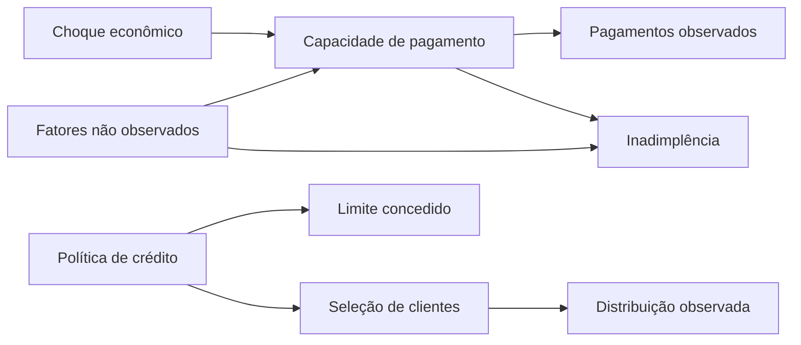

# Hipóteses e limites causais

Grafo hipotético, não estimado/validado causalmente. A base não mede choque econômico/desemprego. Seleção, políticas e variáveis omitidas limitam atribuição/transporte.

Data drift transforma LIMIT_BAL/PAY_AMT1 mantendo outros X e labels. Causa da distribuição é conhecida no programa; não conclui efeito de inflação real. Labels após alterar X são ilustração contrafactual, não observação da economia alterada.

Concept drift mantém X do controle e substitui y em PAY_0<=0 por Bernoulli(0,65). Muda P(y dado X) com labels sintéticos. Diferença de desempenho tem causa controlada nessa simulação, sem prever comportamento real dos clientes.

PSI/KS não provam causa econômica/viés nem determinam intervenção. Produção: investigar fonte, mix, seleção/política; obter labels; comparar segmentos; documentar hipótese; validar retraining/recalibração; revisar promoção e preservar rollback.
