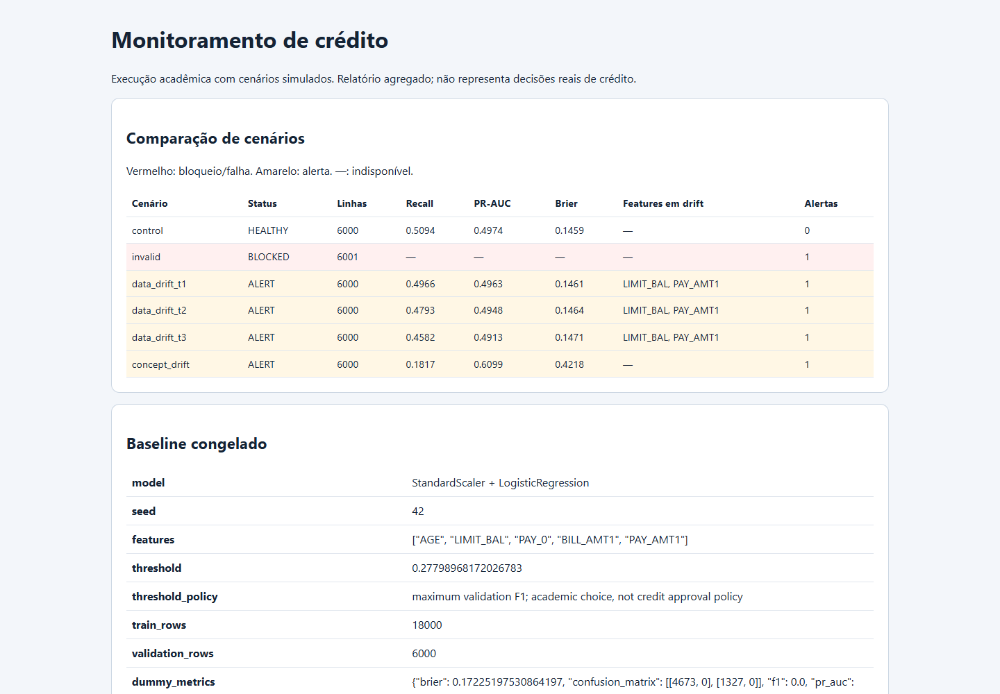
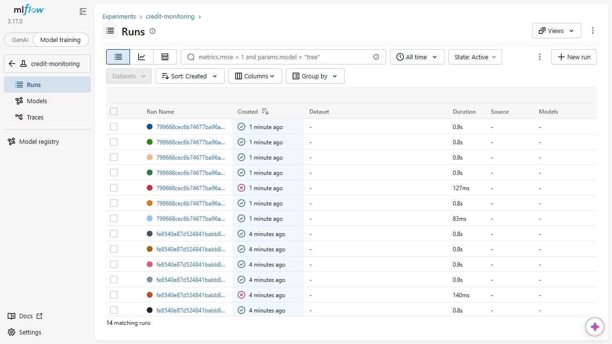
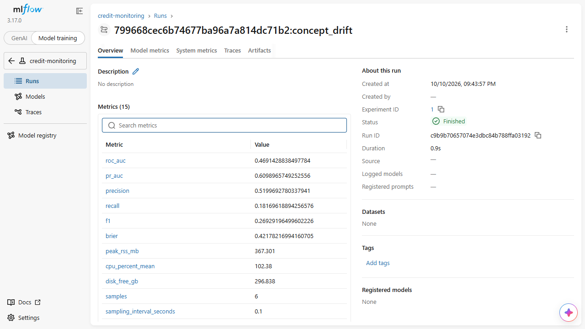

# Evidências da execução validada

Commit de implementação: `40fca715b53ff5baba76f7566a2b557776ddf3c2`.
Batch: `799668cec6b74677ba96a7a814dc71b2`.
Fingerprint das fontes: `55fdf815f3d61aa8dbfaf0d1d05c26381cd5a42339ade04b9dd1d6c638d90051`.

Dataset: 30.000 registros reais, splits 18.000/6.000/6.000, sem linhas descartadas.

| Cenário | Estado | Recall | PR-AUC | Brier | Features em drift |
|---|---|---:|---:|---:|---|
| control | HEALTHY | 0.5094 | 0.4974 | 0.1459 | - |
| invalid | BLOCKED | - | - | - | - |
| data_drift_t1 | ALERT | 0.4966 | 0.4963 | 0.1461 | LIMIT_BAL, PAY_AMT1 |
| data_drift_t2 | ALERT | 0.4793 | 0.4948 | 0.1464 | LIMIT_BAL, PAY_AMT1 |
| data_drift_t3 | ALERT | 0.4582 | 0.4913 | 0.1471 | LIMIT_BAL, PAY_AMT1 |
| concept_drift | ALERT | 0.1817 | 0.6099 | 0.4218 | - |

Controle sem alertas; lote inválido inteiro (6.001 linhas) bloqueado antes de prever. No concept drift, X idêntico ao controle, recall cai de 0,5094 para 0,1817 e Brier aumenta de 0,1459 para 0,4218.

A prevalência de inadimplência muda de 0.2212 para 0.6210 nos labels sintéticos. PR-AUC aumenta nominalmente; isso não contradiz perda de recall/calibração. Average precision depende da prevalência e não deve ser interpretada isoladamente como melhora global.

## Estatísticas da janela t3

| Feature | PSI | KS |
|---|---:|---:|
| AGE | 0.0027 | 0.0147 |
| LIMIT_BAL | 0.8948 | 0.3232 |
| PAY_0 | 0.0005 | 0.0063 |
| BILL_AMT1 | 0.0013 | 0.0113 |
| PAY_AMT1 | 1.6978 | 0.5709 |

12 verificações de evidências passaram (reports/verification.json). 38 testes passaram no Windows/Python 3.13.6; dependências e Ruff aprovados. CI Linux/Python 3.13 também concluiu testes e demo na base completa.

[GitHub Actions validado](https://github.com/marcellossf/tech-challenge-credit-monitoring/actions/runs/38099510133).

## Telas conferidas

## Limites da evidência

- Janelas sintéticas usam o mesmo holdout; não há validação temporal real.
- Labels sintéticos só no concept drift; labels transportados no data drift são ilustração contrafactual.
- Sem decisão real de crédito, generalização ao Brasil ou certificação de equidade/compliance.
- CPU/RSS/disco medidos localmente por amostragem; não equivalem a SLA de serviço.
- Vídeo, acesso institucional e recibo de envio ainda pendentes.

Para filmar: abrir reports/index.html e usar Model training > credit-monitoring no MLflow local. O modo padrão GenAI não mostra os runs deste classificador. Usar porta 5001 e --workers 1 no Windows.
